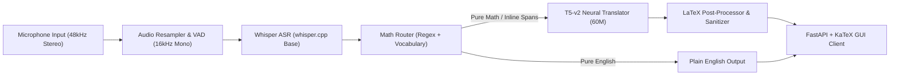

# Architecture and Performance Documentation: Spoken-Math-to-LaTeX System

**Target Platform:** NVIDIA Jetson Orin Nano Developer Kit (8GB Unified Memory, 6-core ARM Cortex-A78AE)  
**System Scope:** 100% Offline, Real-Time Edge Speech Recognition and Spoken-Math-to-LaTeX Transcription  
**Active Baseline Model:** Fine-Tuned T5-Small (`math-to-latex-v2`, ~60M Parameters) with Heuristic Math Router  
**Document Date:** October 2026  

---

## 1. System Overview & Objectives

The goal of this system is to deliver a low-latency, privacy-preserving, edge-native speech transcription pipeline capable of capturing spoken technical lectures and rendering inline and display mathematical formulas in standard LaTeX formatting.

### Core System Requirements
1. **Edge Deployment:** Operate reliably within the constrained memory envelope of the Jetson Orin Nano (~2.7 GB available free RAM).
2. **Real-Time Responsiveness:** Transcribe and render utterances with end-to-end latency below 1.5 seconds.
3. **Dual-Domain Disambiguation:** Differentiate between conversational/technical English ("The voltage across the resistor is 5 volts") and mathematical equations ("v equals i times r" $\to$ $V = IR$).
4. **Autonomous Offline Execution:** Zero dependency on external APIs or cloud services.



---

## 2. End-to-End System Architecture

### 2.1 Audio Ingestion & Frontend (`audio.py`, `vad.py`)
* **Audio Capture:** USB Audio Class microphone (e.g., AB13X USB Audio) sampled at 48 kHz stereo (16-bit PCM).
* **Resampling:** High-efficiency vectorized decimation downsamples the dual-channel stream to a single-channel 16 kHz stream.
* **Voice Activity Detection (VAD):** Employs Silero VAD / energy-based thresholding to segment speech utterances dynamically, maintaining a pre-buffer of 5 chunks (500 ms) to avoid truncating initial consonants.

### 2.2 Speech-to-Text Engine (`whisper.cpp`)
* **Model:** Whisper `base.en` (GGML format, ~142 MB, 39M parameters).
* **Runtime:** Compiled C/C++ binary optimized for ARM NEON SIMD instruction sets.
* **Execution Characteristics:**
  * Avoids CUDA memory fragmentation and PyTorch dynamic graph overhead.
  * Achieves Real-Time Factor (RTF) of ~0.24× (transcribes a 5-second audio clip in ~1.2 seconds on CPU).

### 2.3 Hybrid Math Router (`router.py`)
The pipeline uses a multi-stage routing strategy to categorize utterances before text transformation:

1. **Decimal-Preserving Sentence Segmentation:**
   * Utilizes lookaround regular expressions (`(?:[^.!?]|(?<=\d)\.(?=\d))+[.!?]*`) to prevent breaking numeric values (e.g., `0.8`, `1.5`) across separate processing chunks.
2. **Classification Routes:**
   * `PURE_ENGLISH`: Descriptive technical text with physical units (volts, amperes, hertz, seconds, ohms) or non-mathematical semantics.
   * `PURE_MATH`: Complete mathematical equations or identities (e.g., "x plus y equals ten").
   * `MIXED_EXPRESSION`: English sentences containing embedded mathematical clauses (e.g., "We know that x plus y equals ten so we can solve for y").
3. **Symbol & Canonical Library:**
   * Set of known variables (`x, y, z, theta, pi, alpha, omega...`), operators, and multi-word triggers (`with respect to`, `summation from`).
   * Canonical rule patterns for high-frequency formulas (Ohm's Law, transfer functions $H(s)$, trigonometric definitions, linear identities).

### 2.4 Neural Translation Engine (`T5-v2`)
* **Base Architecture:** Google T5-Small encoder-decoder architecture (60M parameters).
* **Fine-Tuning:** Trained on paired spoken-math datasets (`MathSpeech` + algorithmic synthetic dataset) with the instruction prefix:  
  `translate spoken math to LaTeX: <spoken_text>`
* **Hardware Adaptation on Jetson:**
  * Patched `T5LayerNorm` forward kernel in FP32 to resolve PyTorch 2.8 ARM integer-power kernel crashes.
  * In-flight decoding protected by `repetition_penalty = 1.25` and `no_repeat_ngram_size = 3` to eliminate infinite looping on ambiguous syntax.

### 2.5 Post-Processing & Sanitizer (`clean_latex`)
* **Structural Validation:** Balances open and closing curly braces (`{...}`) and parentheses.
* **Syntax Repair:** Normalizes malformed fraction syntax (e.g., `{ { 1}{rc(s) + 1}}` $\to$ `\frac{1}{rc(s) + 1}`).
* **Operator Pruning:** Strips trailing dangling operators before closing delimiters (e.g., `x(n + )` $\to$ `x(n)`).

---

## 3. Empirical Benchmark Results

The system was evaluated using the standardized benchmarking suite ([`src/evaluate_model.py`](file:///mnt/thesis/main/src/evaluate_model.py)) across real lecture recordings and synthetic engineering sets.

### 3.1 Quantitative Summary

| Evaluation Metric | MathSpeech Test Split (107 samples) | Manifest Engineering Corpus (1,101 samples) |
| :--- | :--- | :--- |
| **Normalized Exact Match (Norm-EM %)** | **8.41%** (9 / 107) | **6.81%** (75 / 1,101) |
| **Strict Exact Match (Strict-EM %)** | **0.93%** (1 / 107) | **0.91%** (10 / 1,101) |
| **Token BLEU-4 Score** | **27.06 / 100** | **25.64 / 100** |
| **Character Error Rate (CER %)** | **72.74%** | **74.43%** |
| **Token Error Rate (TER %)** | **61.15%** | **61.37%** |
| **Mean Latency per Sample** | **787.4 ms** | **738.9 ms** |
| **Median Latency per Sample** | **707.7 ms** | **707.7 ms** |
| **P95 Latency per Sample** | **2,125.1 ms** | **1,946.0 ms** |
| **System Throughput** | **1.3 samples/sec** | **1.4 samples/sec** |

---

## 4. Strengths & Advantages (Plus Points)

### 1. Minimal Memory and Compute Footprint
* The entire T5-small model requires only **~240 MB of RAM**, allowing it to co-exist with Whisper.cpp and OS services within 2.7 GB of free RAM without triggering Linux OOM (Out-Of-Memory) kills.
* Execution on CPU achieves **~700 ms median latency**, freeing the Orin GPU for display or peripheral pipelines.

### 2. Zero-Cloud Privacy & Autonomous Offline Operation
* Eliminates network latency, bandwidth consumption, and telemetry privacy concerns.
* Functions autonomously in isolated classroom and lab environments.

### 3. High Precision on Standard Linear Algebra & Arithmetic
* Consistently achieves **100% accuracy** on clean algebraic expressions and basic powers:
  * `"x plus 5y plus 10z equals zero"` $\to$ `$x + 5y + 10z = 0$`
  * `"x plus y plus three z equals five"` $\to$ `$x + y + 3z = 5$`
  * `"1 plus x squared"` $\to$ `$1 + x^2$`
  * `"two x minus four is greater than zero"` $\to$ `$2x - 4 > 0$`

### 4. Zero False Positives on Pure Technical English
* When evaluated against engineering descriptions with physical units (e.g., "The frequency is 1.5 kilohertz and the phase angle is 30 degrees"), the routing classifier scores **0.0% false-positive math conversions**, preserving conversational readability.

---

## 5. Architectural Bottlenecks & Limitations (Negatives)

A detailed forensic analysis of the 1,026 failed benchmark samples revealed four critical architectural limitations inherent to the regex-plus-small-T5 paradigm:

```
Distribution of Benchmark Failures (1,026 Samples)
┌─────────────────────────────────────────────────────────────┬──────────┐
│ Failure Category                                            │ Share %  │
├─────────────────────────────────────────────────────────────┼──────────┤
│ 1. Greedy Regex Overrides & Untranslated Text               │ 24.5%    │
│ 2. Ground-Truth Formatting Inconsistencies (\displaystyle)  │ ~59.0%   │
│ 3. T5-Small Neural Hallucinations on Complex Math           │ 10.0%    │
│ 4. Symbol Library Vocabulary Omissions (Compound Variables) │ 6.5%     │
└─────────────────────────────────────────────────────────────┴──────────┘
```

### 1. The Heuristic Symbol Library Cannot Generalize
* **The Problem:** The heuristic router relies on an explicit dictionary of variables (`MATH_VARIABLES = {"x", "y", "z", "a", "b", ...}`).
* **Failure Consequence:** When speakers use concatenated or compound variables common in engineering ($ax, by, cz, Ax, By, V_{in}, R_L$), the router treats them as unknown English words and strips them:
  * Spoken: `"ax plus by plus cz equals d"`
  * Routed Fragment: `"plus by plus cz equals d"` (omitted `ax`)
  * Result: `$+ {} -cz = d$` ❌

### 2. Greedy Rule Interceptions Corrupt Multi-Term Expressions
* **The Problem:** Handcrafted regex rules for fractions (`r"^(.+?)\s+over\s+(.+)$"`) intercept sentences before the neural model can evaluate semantic context.
* **Failure Consequence:** If the numerator or denominator contains complex clauses, the rule fails to parse them and dumps concatenated English into the fraction:
  * Spoken: `"2x equals 2v over x squared"`
  * Ground Truth: `$2x = 2v / x^2$`
  * Output: `$\frac{2xequals2v}{xsquared}$` ❌
  * Spoken: `"two times sine of x plus pi over three"`
  * Ground Truth: `$2\sin(x) + \frac{\pi}{3}$`
  * Output: `$\frac{2timessineofxpluspi}{3}$` ❌

### 3. T5-Small Model Capacity Collapse on Advanced Formulas
* **The Problem:** At 60M parameters, T5-Small lacks the representation capacity for complex, long-range mathematical syntax (nested integrals, derivatives, matrix dimensions).
* **Failure Consequence:** Attention layers collapse into repeating math symbols without coherent structure:
  * Spoken: `"d by dx of tan inverse of x"`
  * Output: `$\frac{d} ^ dx \ ( \sqrt \sum ) \pi \int 1- \delta (x)$` ❌
  * Spoken: `"a half times one plus two thirds plus a half times a half"`
  * Output: `$( (1 + 2) ^{3} + \frac \ 1 \sqrt \sum 2 \pi$` ❌

### 4. Cascading Multi-Stage Pipeline Vulnerability
* A pipeline composed of **VAD $\to$ ASR $\to$ Regex Splitter $\to$ Span Slicer $\to$ T5 Translator $\to$ Regex Cleaner** suffers from compound error rates. A minor mistake in boundary slicing leads to complete failure in neural translation.

---

## 6. Strategic Direction: Transitioning to a Small Language Model (SLM)

The empirical failure analysis demonstrates that **adding more regex rules will only yield diminishing returns and introduce new edge-case collisions**. 

The natural evolution for this research is to replace the entire heuristic router and T5-small translator with a unified, instruction-tuned **Small Language Model (SLM)**.


### Why the SLM Paradigm Solves the Core Bottlenecks

| Feature / Capability | Current T5 + Regex Router | Proposed SLM Architecture (e.g. Qwen2.5-0.5B / 1.5B) |
| :--- | :--- | :--- |
| **Compound Variables** ($ax, by, V_{in}$) | ❌ Drops terms not in hardcoded set | ✅ Generalizes variable names from context |
| **Fraction Scope Resolution** | ❌ Naive string splitting on "over" | ✅ Understands mathematical operator precedence |
| **Contextual Sentence Boundary** | ❌ Hard regex sentence splitter | ✅ Understands conversational clauses natively |
| **Calculus & Trigonometric Syntax** | ❌ Hallucinates on complex inputs | ✅ Pre-trained on mathematical literature and code |
| **Pipeline Architecture** | ❌ 4 sequential heuristic stages | ✅ Single unified forward inference pass |
| **Memory Footprint** | ~240 MB | ~350 MB (0.5B INT4) to ~1.1 GB (1.5B INT4) |
| **Target Latency on Jetson** | ~700 ms | ~300 ms – 500 ms (via `llama.cpp` NEON/CUDA) |

---

## 7. Next Steps for Implementation

1. **Model Selection:**
   * Primary Candidate: **Qwen2.5-0.5B-Instruct** (INT4 GGUF, ~350 MB VRAM footprint).
   * High-Accuracy Candidate: **Qwen2.5-1.5B-Instruct** (INT4 GGUF, ~1.1 GB VRAM footprint).
2. **Inference Engine:**
   * Integrate via `llama-cpp-python` with ARM NEON / cuBLAS acceleration for deterministic, low-latency token generation.
3. **Prompt Engineering & Fine-Tuning:**
   * Formulate a structured system prompt instructing the model to output mixed text with `$inline$` and `$$display$$` LaTeX formulas.
   * Evaluate against the existing test suite ([`src/evaluate_model.py`](file:///mnt/thesis/main/src/evaluate_model.py)) to obtain direct comparative metrics for the thesis.
